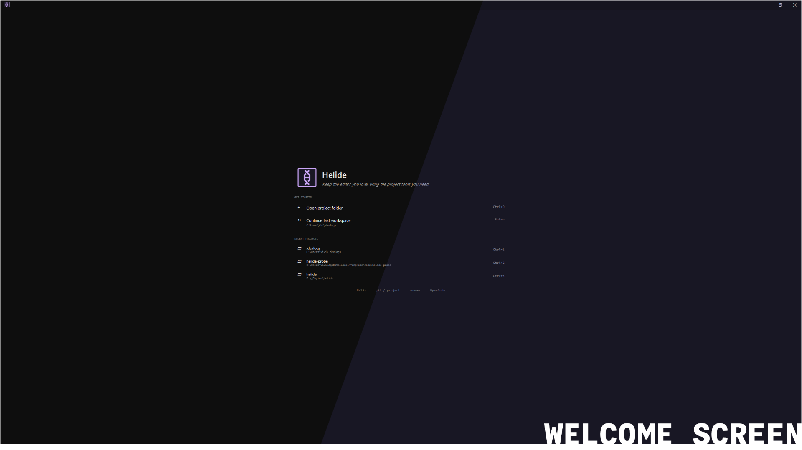
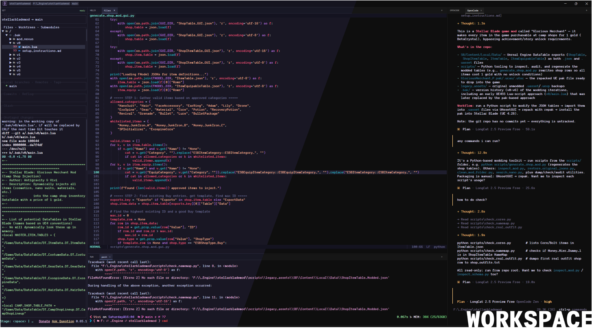
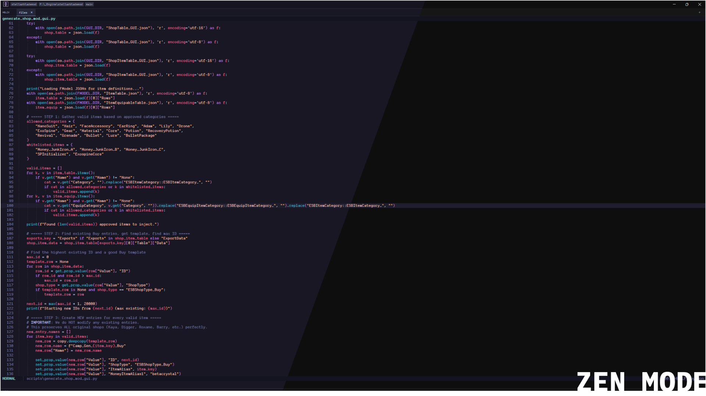
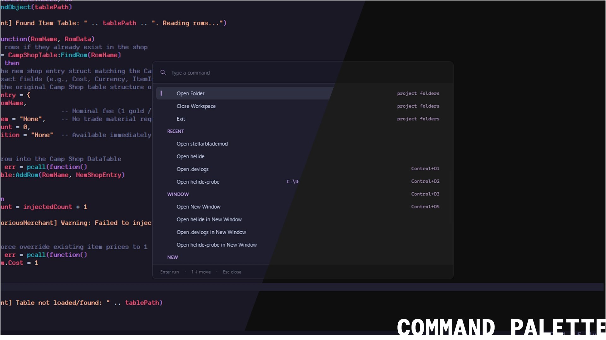
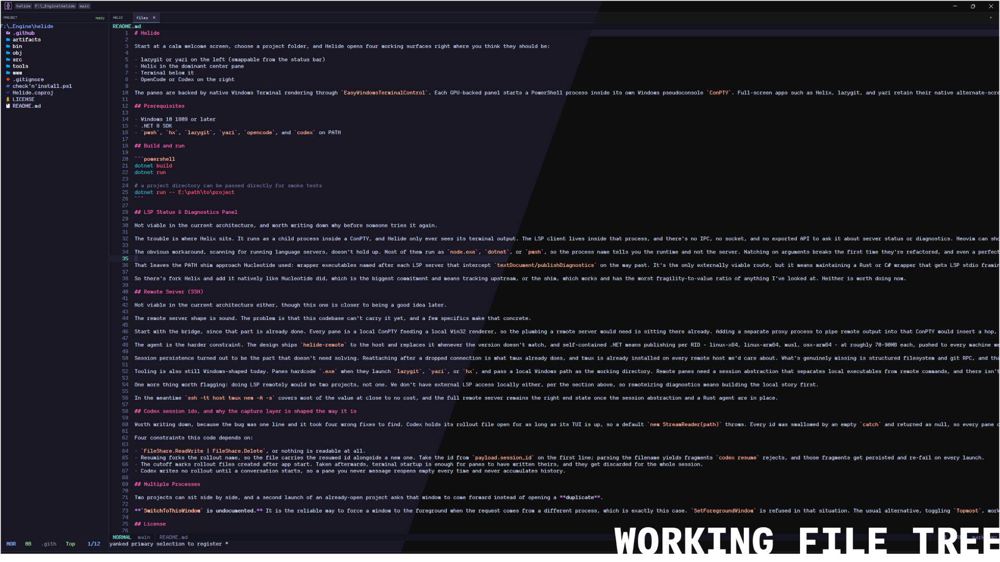

<!-- markdownlint-disable MD024 MD013 -->

# Helide



Start at a calm welcome screen, choose a project folder, and Helide opens a workspace familiar to home.

The workspace layout consists of:

- **Left Panel**
  - Project Browser via Yazi (`yazi`)
  - Git Control via LazyGit (`lazygit`)
- **Center Panel**
  - Code Editor via Helix (`hx`)
  - Shell Access via Terminal (`pwsh`)
- **Right Panel**
  - Agent support via OpenCode (`opencode`, version 2)
  - Agent support via Codex (`codex`)
  - Agent support via Claude Code (`claude`)

Editor and terminal tabs can be split into as many panes as you like, side by side or one above another. See [Split Panes](#split-panes).



Each pane is its own process (`pwsh`, `hx`, `lazygit`, `yazi`, `opencode`, `codex`, `claude`) running in its own Windows pseudoconsole through `ConPTY`, GPU-backed by `EasyWindowsTerminalControl`. Full-screen apps such as Helix, lazygit, and yazi retain their native alternate-screen semantics.

Download the release executable from the [Latest Release](https://github.com/ujjwalvivek/helide/releases/latest). Application updates are automatic, and each release publishes a `SHA256SUMS.txt` that the in-app updater verifies the download against.

Or, if you wish to build the binary yourself, see below.

## Prerequisites

- Windows 10 1809 or later
- .NET 8 SDK
- `hx`, `lazygit` and `yazi`
- `pwsh` is preferred for the runner; Helide falls back to Windows PowerShell, then `cmd`
- Agents are optional: any of `opencode` (version 2 is required), `codex` or `claude`

No .NET install is needed to run the self-contained release. The .NET 8 SDK is only for building from source.

Helide checks for these itself. The welcome screen lists each tool with a mark when it is found, and if one is missing it offers to `winget install` for it. Tools installed that way, or placed in winget's package folder, are picked up without a restart.

If you wish to build from source and repairing PATH, see [CheckNInstall Utility](#checkninstall-utility).

## Build and Run

```sh
# Debug build and run
dotnet build
dotnet run

# a project directory can be passed directly for smoke tests
dotnet run -- E:\path\to\project

# Release build
dotnet publish -c Release -r win-x64 --self-contained
```

## Repository Layout

```sh
helide/
├── src/
│   ├── App/              # Startup, instance guard, activation watcher
│   ├── Assets/           # Images (duplicated to www/images/)
│   ├── Config/           # Bundled yazi config + opener script (embedded)
│   ├── Interop/          # Win32 / P/Invoke helpers, process tree
│   ├── Persistence/      # AppState, WorkspaceState (JSON)
│   ├── Projects/         # Project loader / session manager
│   ├── Services/         # Update service, per-tool defaults for clean installs
│   ├── Sessions/         # Agent session tracking
│   ├── Shell/            # Command palette, folder picker, and split panes
│   ├── Terminal/         # Native terminal host (ConPTY)
│   └── Theme/            # Theme palette and XAML resources
├── tools/
│   ├── AutoUpdater/      # TUI updater CLI (deprecated, kept for reference)
│   └── CheckNInstall/    # Dependency checker / installer
├── www/                  # Static Helide site
├── check'n'install.ps1   # Launcher for tools/CheckNInstall
└── README.md
```

## Tools and Utilities

### AutoUpdater Utility (Deprecated)

**Deprecated.** Helide updates itself, so releases no longer ship `AutoUpdater.exe` and the build and install tools no longer produce it. The code stays in `tools/AutoUpdater` for reference and still builds.

TUI (terminal) CLI updater for Helide. Checks GitHub releases, downloads updates (zip or exe), installs beside Helide, and restarts.

Update source:

- `https://api.github.com/repos/ujjwalvivek/helide/releases/latest`
- Downloads `.zip` or `.exe` asset from GitHub releases
- Extracts `.exe` from zip, installs beside `Helide.exe`

#### Build and Run

```sh
# Debug build
cd tools/AutoUpdater
dotnet build

# Run the binary
dotnet run

# Release build
dotnet publish -c Release -r win-x64 --self-contained
```

**Note**: This utility is not needed to update Helide. The app checks for new updates on restarts and highlights them in the title bar and the About page. An install managed by winget is left to winget (`winget upgrade ujjwalvivek.Helide`).

### CheckNInstall Utility

Interactive TUI that checks the CLIs Helide shells out to, installs what is missing, repairs PATH, publishes the single-file builds, and installs them. The user PATH is guarded at 2000 characters for safety.

It opens on a status screen (tools, agents, what is installed) and offers three workflows:

| Workflow               | Does                                                          |
| ---------------------- | ------------------------------------------------------------- |
| Set up everything      | Fix tools, then build and install Helide                      |
| Fix tools              | Check, `winget install` what is missing, repair PATH          |
| Build & install Helide | Publish Helide, then install it                               |

#### Build and Run

```sh
# Debug build
cd tools/CheckNInstall
dotnet build

# Run the binary (with flags)
dotnet run           # interactive menu
dotnet run --check   # report only, exit 0 when ready
dotnet run --full    # every phase, no prompts

# Release build
dotnet publish -c Release -r win-x64 --self-contained
```

#### Phases

It goes through 5 phases:

1. Checks that `lazygit`, `hx` and `yazi` are on PATH. `pwsh` is installed when missing but is never a blocker. The agents (`opencode`, `codex`, `claude`) are only reported
2. `winget install` each missing one. Agents are never installed
3. `WinGet\Links` can be empty, so `WinGet\Packages` is added to the user PATH. The user PATH is read and written as stored, a literal `%PATH%` entry is warned about, and Explorer is told the environment changed
4. Builds with `-r win-x64 --self-contained`, into `bin\Release\net8.0-windows\*-win-x64.exe`
5. Finally, installs into `%LOCALAPPDATA%\Programs\Helide\`, and the user PATH.

**Note**: Installation also creates a Start Menu entry for `Helide.exe`.

## Configurations and Settings

Settings and configs are persisted under `%LOCALAPPDATA%\Helide`.

| File                   | Key / Setting      | Values                                          | Description                    |
| ---------------------- | ------------------ | ----------------------------------------------- | ------------------------------ |
| `state.json`           | `Theme`            | `"mocha"`, `"oled"`                             | Active color theme             |
| `state.json`           | `LastProjectPath`  | `string`                                        | Last opened project directory  |
| `state.json`           | `RecentProjects[]` | array                                           | Up to 8 recent projects        |
| `state-ws-{hash}.json` | `Window`           | `Left`, `Top`, `Width`, `Height`, `IsMaximized` | Window geometry                |
| `state-ws-{hash}.json` | `Layout`           | ratios + `LeftCollapsed`, etc.                  | Pane ratios and collapse state |
| `state-ws-{hash}.json` | `AgentSessions[]`  | `Type`, `Name`, `SessionId`, `WorkingDirectory` | Agent tab state                |
| `state-ws-{hash}.json` | `EditorTabs[]`     | `Path`                                          | Open file paths                |
| `state-ws-{hash}.json` | `EditorSplit`      | tree of `Tab`, `Row`, `Weight`, `Children`      | How editor tabs are split      |
| `state-ws-{hash}.json` | `RunnerSplit`      | same tree, with `RunnerPanes[]`                 | How terminal panes are split   |
| `state-ws-{hash}.json` | `ActiveAgentIndex` | `int`                                           | Which agent tab was selected   |
| `state-ws-{hash}.json` | `Layout.Zen`       | `bool`                                          | Zen mode, and what to restore  |
| `state.json`           | `YaziOpenInHelide` | `bool`                                          | yazi config installed          |
| `state.json`           | `AiEnabled`        | `bool`                                          | Whether the agent pane exists  |

**Reset**: delete the `.json` files. Per-project workspace files are named by a SHA-256 hash of the full project path (`state-ws-*.json`). `%LOCALAPPDATA%\Helide\open-request.txt` is deleted and recreated on every launch, so removing it by hand changes nothing.

## Features

### Familiar Workspace

Every pane, left pane (`lazygit` & `yazi`), bottom runner terminal (`pwsh`), and right agents pane (`opencode` & `codex`), can be expanded or collapsed independently. `F11` (or **Zen Mode** in the command palette) closes every panel and folds away the title bar and the editor's tab strip, leaving only the center editor (`hx`), for an uninterrupted workflow. Collapse state is part of the persisted workspace file (`state-ws-{hash}.json`), so closing and reopening a project restores the exact same panel visibility. The layout ratios and collapse flags are persisted.



Editor buffers, agents, and terminal runners all share the same tabbed surface model. New files open directly from the working file tree or from the command palette. Agents get tabbed support for multi agentic sessions, and the session state is persisted per project in `state-ws-*.json`. Multiple terminal tabs to run various commands at once. `CTRL+P` will bring up a command palette that works across panels cohesively, keyboard-driven fuzzy command runner.



Editor tabs and terminal tabs can be split into panes, nested as deeply as you want. The split arrangement is saved per project (`EditorSplit`, `RunnerSplit`). Closing the last terminal or agent tab closes its panel.

### Tool Defaults

On a machine where nobody has configured them, Helide gives the tools it hosts a look that matches it. None of it is written into a tool's own config directory, stored `%LOCALAPPDATA%\Helide` and are passed on the command line or through the environment.

### Persisted Layout

The layout engine (`WorkspaceLayoutState`) divides the window into ratios, and each surface can be expanded or collapsed independently without losing its contents. Layout is saved across restarts per project in a file named by a SHA-256 hash of the full project path (`state-ws-{hash}.json` under `%LOCALAPPDATA%\Helide\`). The file includes window geometry, pane ratios and collapse flags, open editor tabs and how they are split, how the terminal panes are split, active agent index, and agent sessions.

### Working File Tree



Project browser via `yazi` that helps navigates, selects, and opens files directly in the Helix editor. See [Yazi Configuration](#yazi-configuration).

**TLDR;** The pane runs the real `yazi.exe` in its own ConPTY, so the tree is yazi itself rather than a reimplementation. Selection is handed to Helide through yazi's own `[opener]` rules: a script appends the chosen path to `open-request.txt`, which Helide watches and drains by byte offset into an editor tab. Each new file opens in its own tab in the center panel, and the open tabs are persisted per project (`EditorTabState.Path`).

## Yazi Configuration

Out of the box yazi opens files with whatever Windows picks, which spawns stray windows outside Helide. Opening it inside Helide will need a bit of tweaking.

Helide offers to install its own yazi config. While it is missing, the project browser shows an offer card (`YaziPromptCard`) instead of the file tree, and yazi itself is not started until you answer. The offer comes back whenever you open the project browser, until the config is in place.

Accepting this will install four files in your Yazi's config directory at `%APPDATA%\yazi\config\` and restarts the app. Declining it will open Yazi with your/default config. Nothing is installed. The same install is available any time from the command palette as **Open Project Browser Files in Helide** (View).

| File                   | What it does                                                                    |
| ---------------------- | ------------------------------------------------------------------------------  |
| `yazi.toml`            | Sidebar layout (`ratio = [0, 1, 0]`), sorting, mouse, and the `[opener]` rules  |
| `keymap.toml`          | `g d`, `g o`, `S`, `H`, `L`, `O`, `h`/`l` and arrow/`BS` movement for a sidebar |
| `theme.toml`           | Helide's own palette so yazi does not read as a foreign app in the pane         |
| `open-with-helix.ps1`  | The script the openers call. Also the marker file for "installed"               |

Anything inside that folder is backed up to `%APPDATA%\yazi\config\helide-backup-<yyyyMMdd-HHmmss>\`, so accepting the offer costs nothing that cannot be undone. Restore by deleting the four installed files and moving the backup contents back. Deleting `open-with-helix.ps1` (or restoring a backup) makes Helide offer again.

### How A File Reaches The Editor

1. Yazi's `[opener]` entries (both `edit` and `open`) run `open-with-helix.ps1 %s`.
2. The script appends the path to the file named by `HELIDE_OPEN_REQUEST`, an environment variable Helide exports to the processes it launches. That file is `%LOCALAPPDATA%\Helide\open-request.txt`.
3. Helide watches it with a `FileSystemWatcher` and consumes it by byte offset, so two writes cannot be read as one half-line.
4. Each drained path opens in a tab in the center editor pane.

### Details Worth Knowing

- `%s` is deliberately unquoted in `yazi.toml`. Yazi quotes substituted paths itself, and a second layer turns one path into two arguments that do not exist.
- There is no wildcard `[open]` rule on purpose. A `{ url = "*" }` rule captures directories too, and a directory matching an opener is handed to the opener instead of being descended into -- folders stop expanding.
- The text/binary call is made per file by the script, not by an extension list. Helix renders text, so a NUL byte in the first 8KB sends the file to `Start-Process` and lets Windows pick a handler.
- A directory reaching the script is handed back to yazi via `ya emit cd`.
- `orphan = true` and no `block`: yazi does not drop to the alternate screen on every open, and nothing waits on PowerShell startup.
- Standalone yazi with no Helide running just calls `hx` directly, so the config is harmless outside Helide.

**Note**: This is still not a foolproof solution, there might be a slip in opening a file here or a directory there. If that happens, please raise an issue.

## Agent Sessions

Agents are optional. Helide offers whichever of `opencode`, `codex` and `claude` it finds on `PATH` (as `.exe`, `.cmd` or `.bat`) and leaves the rest out of every menu. None is required.

The whole feature sits behind one switch, off by default: the banner on the welcome screen, or **Enable AI** / **Disable AI** in the command palette (`AiEnabled` in `state.json`). While it is off there is no agent pane and no agent commands. Saved sessions are not touched, so turning it back on reopens each workspace's conversations.

To restore a conversation Helide has to know which session a pane is on. Where the agent allows it, Helide chooses the id itself instead of working it out afterwards:

| Agent    | How the pane gets its session id                                                    |
| -------- | ----------------------------------------------------------------------------------- |
| OpenCode | Helide generates the id and launches the TUI onto it                                |
| Claude   | Helide generates a UUID: `--session-id <id>` the first time, `--resume <id>` after. |
| Codex    | Cannot be told an id, so it is read from the rollout file the pane writes on start  |

`src/Sessions` holds the implementation:

| File                         | Role                                                          |
| ---------------------------- | ------------------------------------------------------------- |
| `AgentProviders.cs`          | The known agents and which are installed                      |
| `ISessionStatusSource.cs`    | The contract: `IsBusy`, `BecameIdle`, `Start`                 |
| `OpenCodePaneConfig.cs`      | Builds each OpenCode pane's launch script                     |
| `OpenCodeSessions.cs`        | Session id, and session state read from the opencode database |
| `OpenCodeStatusSource.cs`    | Polls that database and decides when a turn ended             |
| `CodexSessions.cs`           | Locates codex rollout files and reads their session ids       |
| `ClaudeSessions.cs`          | Claude session ids, the live ids, and turn markers            |
| `OpenCodeVersion.cs`         | Finds an OpenCode 2 on PATH and decides whether the pane runs |
| `TranscriptStatusSource.cs`  | Busy/idle for Codex and Claude from their own transcripts     |
| `QuietPeriodStatusSource.cs` | Fallback that guesses from terminal silence                   |

Codex and Claude both keep a transcript on disk and mark turn boundaries in it, so they share `TranscriptStatusSource`; only which record means "started" and "finished" differs. OpenCode keeps its sessions in one SQLite database, so `OpenCodeStatusSource` polls that instead, off the UI thread, and reports idle only on a transition from _was running_ to _finished_.

## FAQs

### Why WPF?

Helide uses C# for its development. I wanted to use Helix in a way that fgeels familiar to me, and on Windows. I wanted something native, and C# IS kinda *native* to Windows.

### Does Helide have a remote server for remote development?

Not viable in the current architecture, the problem being that this codebase can't carry it yet. Though this one is closer to being a good idea later.

So answer is No. If you wish to know more, read below.

Every pane is a local ConPTY feeding a local Win32 renderer. Adding a separate proxy process to pipe remote output into that ConPTY would insert a hop, a resize relay, and a new way for panes to fail. Which is fine, and solvable through multiple iterations.

Much harder constraint is the remote agent. The design should ship `helide-remote` binary to the host and replaces it whenever the version doesn't match, and self-contained .NET means publishing per RID - linux-x64, linux-arm64, musl, osx-arm64 - at roughly 70-90MB each, pushed to every machine we connect to. Which obviosuly sounds like a bad idea. On the contrary, Rust cross-compiled to static musl is 3-10MB per architecture. At that size difference the deployment is too tempting not to try, but that would need an architectural rewrite.

Tooling is also still Windows-shaped today. Panes hardcode `.exe` when they launch `lazygit`, `yazi`, or `hx`, and pass a local Windows path as the working directory. Remote panes need a session abstraction that separates local executables from remote commands, and there isn't one yet. That abstraction has to come first regardless of which direction this goes.

In the meantime `ssh -tt host tmux new -A -s` covers most of the value at close to no cost, and the full remote server remains the right end state once the session abstraction and a Rust agent are in place. One more thing worth flagging: doing LSP remotely would be two projects. We don't have external LSP access locally either, per the section above, so remoteizing diagnostics means building the local story first.

## Does Helide have a Diagnostics Panel?

Again, Not viable in the current architecture, so no.

If you wish to know more, read below.

The trouble is where Helix sits. It runs as a child process inside a ConPTY, and Helide only ever sees its terminal output. The LSP client lives inside that process, and there's no IPC, no socket, and no exported API to ask it about server status or diagnostics. Neovim can show `:LspInfo` because its client is also inside the process, which is where the information lives.

The obvious workaround, scanning for running language servers, doesn't hold up. Most of their process name tells you the runtime and not the server they're running. So matching names break, and even a perfect match says nothing about their state (starting, ready, and failed). Helix does log LSP events under `%LOCALAPPDATA%\helix\`, but the format isn't stable or documented, so parsing it is guesswork, and there are no structured diagnostic events to hook into regardless.

That leaves the PATH shim approach [Nucleotide](https://github.com/iainh/nucleotide) used: wrapper executables named after each LSP server that intercept `textDocument/publishDiagnostics` on the way past. It's the only externally viable route, but it means maintaining a Rust or C# wrapper that gets LSP stdio framing right for every server we care about. High maintenance, very very brittle, and has the worst fragility-to-value ratio of anything I've looked at.

## Acknowledgements

- [Helix](https://helix-editor.com/): modal editor
- [lazygit](https://github.com/jesseduffield/lazygit): git UI
- [yazi](https://yazi-rs.github.io/): terminal file manager
- [Opencode](https://github.com/anomalyco/opencode): agent workspace
- [Codex](https://openai.com/index/introducing-codex/): agent assistant
- [Claude](https://github.com/anthropics/claude-code): agent assistant
- [EasyWindowsTerminalControl](https://github.com/claytonbd/EasyWindowsTerminalControl): ConPTY WPF control

## License

Helide is released under the MIT License. See [LICENSE](LICENSE).
